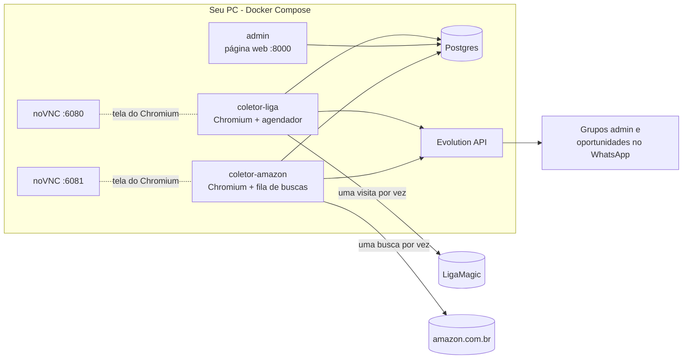

# tcg-sniper

Monitor de preços de produtos selados de Magic: The Gathering (boosters, caixas, kits) na [LigaMagic](https://www.ligamagic.com.br). Uma vez por dia ele lê o catálogo de selados com o menor preço anunciado de cada produto e, para os produtos que você escolher acompanhar, guarda o histórico de venda e o número de lojas. Você administra tudo por uma página web e recebe os avisos num grupo de WhatsApp.

É o primeiro pedaço de um monitor de arbitragem: ele já compara o preço da LigaMagic com o da Amazon e avisa quando há uma oferta bem abaixo; outros marketplaces vêm depois (ver [Roadmap](#roadmap)).

**Estado:** a coleta da LigaMagic, o admin e os avisos no WhatsApp estão prontos e rodando no dia a dia. O sub-projeto 2 (coletor da Amazon, casamento de produtos e oportunidades) também está pronto.

## Índice

- [Uso responsável](#uso-responsável)
- [Como funciona](#como-funciona)
- [Pré-requisitos](#pré-requisitos)
- [Instalação passo a passo](#instalação-passo-a-passo)
- [Atualizar uma instalação existente](#atualizar-uma-instalação-existente)
- [Uso no dia a dia](#uso-no-dia-a-dia)
- [Configuração](#configuração)
- [Solução de problemas](#solução-de-problemas)
- [Desenvolvimento](#desenvolvimento)
- [Roadmap](#roadmap)
- [Licença](#licença)

## Uso responsável

O tcg-sniper foi feito para acessar a LigaMagic como uma pessoa acessaria, em volume baixo:

- **Um acesso por vez, com pausa humana.** Entre uma página e outra há uma pausa aleatória de 8 a 20 segundos. A coleta roda uma vez por dia e nunca há duas ao mesmo tempo.
- **Navegador de verdade.** Usa o Chromium com janela (não headless), com perfil persistente, no seu próprio PC e na sua conexão.
- **Sem burlar proteções.** Não há solucionador de CAPTCHA nem disfarce de navegador. Se o Cloudflare mostrar uma verificação, a coleta pausa, avisa você e espera que uma pessoa a resolva.
- **Amazon com teto e horário.** Na Amazon, a fila tem teto de buscas por hora (200 por padrão) e só roda de 08:00 às 22:00; CAPTCHA pausa a fila até uma pessoa resolver.
- **Só o que a página mostra em texto.** Lê o preço "À partir de" das listagens e o quadro de resumo da página do produto. Os preços de cada loja são desenhados como imagem na página e nunca são decodificados.

Respeite os termos de uso da LigaMagic e não aumente o ritmo da coleta. Este projeto não é afiliado à LigaMagic nem à Wizards of the Coast; Magic: The Gathering é marca da Wizards of the Coast.

## Como funciona



Todo dia, por volta das 10:00:

1. **Listagens.** O coletor abre a listagem de cada categoria de selados (20 por padrão) e clica em "Exibir mais" até mostrar tudo. Daí saem o catálogo e o preço "À partir de" atual de cada produto.
2. **Produtos ativos.** Depois abre a página de cada produto que você marcou como ativo no admin e guarda o número de lojas e o resumo do histórico de venda (mínimo, médio e máximo).
3. **Aviso.** No fim, manda um resumo para o grupo admin do WhatsApp.
4. **Desafio do Cloudflare.** Se aparecer uma verificação no meio do caminho, a coleta pausa e avisa o grupo. Você resolve a verificação pela tela remota (noVNC) e clica em **Retomar** em Serviços.

**Amazon.** De 08:00 às 22:00 o `coletor-amazon` procura cada produto ativo na amazon.com.br, um por vez, com pausa humana. Quando a LigaMagic mostra o nome do produto em inglês, a busca alterna entre o nome em português e o nome em inglês a cada passada. Anúncios novos vão para a fila de revisão em **Casamentos**; só anúncios confirmados geram oportunidade. Quando uma oferta vendida pela Amazon (ou por lojista confiável com envio pela Amazon) fica pelo menos 25% abaixo do "À partir de" da Liga, o grupo de oportunidades recebe um aviso. Ofertas vendidas pela "Amazon Global" (importadas pela própria Amazon) contam como vendidas pela Amazon e também geram aviso; o prazo é mais longo e o imposto de importação pode ser cobrado à parte do preço mostrado. Tudo isso se ajusta em **Configurações** no admin (seções Geral, LigaMagic e Amazon; os valores ficam no banco, não no `.env`).

O `notificador` envia as mensagens da tabela de saída pela Evolution a cada 5 s; se a Evolution ou o WhatsApp estiverem fora, tenta de novo (1, 2, 4… até 30 min). Oportunidades que não saírem em até a validade de Configurações → Geral (padrão 6 h) ficam como expiradas; avisos do admin saem sempre.

Os serviços conversam só pelo banco: o admin grava pedidos ("retomar", "rodar agora") e o coletor os lê a cada minuto.

## Pré-requisitos

- **Um PC que fique ligado no horário da coleta.** Foi feito para Windows com Docker Desktop; também funciona em Linux e macOS.
- **[Docker Desktop](https://www.docker.com/products/docker-desktop/)** (ou Docker Engine com o plugin Compose).
- **[Git](https://git-scm.com/downloads).** No Windows, o Git traz o **Git Bash**: use-o para os comandos deste README.
- **Um chip de WhatsApp secundário.** Nunca use um número pessoal ou de loja: o número fica conectado à Evolution API e manda as mensagens do grupo.
- **Um grupo de WhatsApp de administração**, com você e esse número secundário.

Para desenvolver (opcional): Python 3.12 e [uv](https://docs.astral.sh/uv/). Ver [Desenvolvimento](#desenvolvimento).

## Instalação passo a passo

### 1. Baixe o projeto

```bash
git clone https://github.com/Kyner/tcg-sniper.git
cd tcg-sniper
```

### 2. Crie o `.env`

```bash
cp .env.example .env
```

Abra o `.env` num editor e troque pelo menos:

| Variável | O que colocar |
| --- | --- |
| `ADMIN_SENHA` | Senha da página de admin. |
| `VNC_SENHA` | Senha da tela remota do Chromium. Só os 8 primeiros caracteres valem. |
| `EVOLUTION_API_KEY` | Uma chave longa e aleatória, inventada por você. |

O IP deste PC, a instância e os grupos do WhatsApp não ficam no `.env`: você os preenche em **Configurações** no admin (passos 4 e 5). Cada variável do `.env` está explicada no próprio [`.env.example`](.env.example).

### 3. Suba o banco, a Evolution API, o admin e o notificador

O coletor fica para o passo 6: ao subir, ele já acessa a LigaMagic.

```bash
docker compose up -d --build postgres evolution migrate admin notificador
```

**Deu certo se** `docker compose ps -a` mostrar `postgres`, `evolution`, `admin` e `notificador` em `Up` e `migrate` em `Exited (0)`, e **Serviços** no admin mostrar o Notificador "rodando". Enquanto o WhatsApp não estiver configurado (passos 4 e 5), as mensagens esperam em **Mensagens**, com o motivo em "Último erro".

### 4. Conecte o WhatsApp

Carregue a chave do `.env` no terminal e crie a instância (use um nome sem espaços, igual ao campo **Instância da Evolution API** em **Configurações** → Geral):

```bash
set -a; . ./.env; set +a

curl -X POST http://localhost:8080/instance/create \
  -H "apikey: $EVOLUTION_API_KEY" -H "Content-Type: application/json" \
  -d '{"instanceName":"tcg-sniper","integration":"WHATSAPP-BAILEYS","qrcode":true}'
```

A resposta traz um QR code (em base64). O jeito mais fácil de lê-lo é pelo painel da Evolution, em http://localhost:8080/manager (entre com a `EVOLUTION_API_KEY`): abra a instância `tcg-sniper`, gere o QR code e leia com o WhatsApp do chip secundário (Aparelhos conectados > Conectar um aparelho).

**Deu certo se** a instância aparecer como conectada no painel.

### 5. Descubra o ID do grupo admin

Com o número secundário já no grupo admin:

```bash
curl "http://localhost:8080/group/fetchAllGroups/tcg-sniper?getParticipants=false" \
  -H "apikey: $EVOLUTION_API_KEY"
```

Procure o grupo pelo nome (`subject`) e copie o `id`, que termina em `@g.us`. Abra o admin em `http://<IP deste PC>:8000/configuracoes` e, em **Configurações** → Geral, cole-o em **Grupo de WhatsApp do admin**. Aproveite para preencher **IP ou nome deste PC na rede** (no Windows: `ipconfig`, "Endereço IPv4") e **Instância da Evolution API**. Salve: não precisa reiniciar nada.

### 6. Suba o coletor

Faça isso quando puder acompanhar a primeira coleta:

```bash
docker compose up -d --build coletor-liga
```

**Deu certo se** `docker compose logs coletor-liga --tail 20` mostrar `agendador iniciado`, sem erro.

Na primeira vez, como ainda não há nenhuma coleta, ela começa sozinha em até 30 minutos (não espera as 10:00). Para começar já, use **Rodar agora** em Serviços (passo 7). As listagens de todas as categorias levam cerca de 20 minutos. Dá para acompanhar o Chromium trabalhando pelo noVNC: `http://<IP deste PC>:6080/vnc.html`, com a `VNC_SENHA`.

Ao final, o grupo admin recebe "N produtos novos no catálogo" e o resumo da coleta.

### 7. Escolha os produtos que quer acompanhar

Abra o admin em `http://<IP deste PC>:8000` (usuário qualquer, senha `ADMIN_SENHA`) e vá em **Catálogo**. Todo produto novo entra inativo. Ative um por um ou use os filtros e **Ativar todos deste filtro**.

Cada produto ativo é uma visita a mais por dia na LigaMagic (cerca de 17 segundos cada): 50 produtos somam uns 15 minutos; 250, pouco mais de uma hora. Comece com poucos.

A partir da próxima coleta, os produtos ativos ganham histórico de venda e número de lojas. Para não esperar o dia seguinte, clique em **Rodar agora** em Serviços: como as listagens do dia já foram feitas, só os produtos rodam.

### 8. Ligue a Amazon

1. Crie no WhatsApp o grupo de oportunidades (com o número secundário dentro), descubra o ID dele como no passo 5 e cole em **Configurações** → Geral, no campo **Grupo de WhatsApp de oportunidades**.

2. Suba o coletor da Amazon junto com todo o resto:

   ```bash
   docker compose up -d --build
   ```

   Suba tudo de uma vez, não só o `coletor-amazon`: a nova versão muda o banco (o `migrate` roda antes) e o `coletor-liga` e o `admin` precisam ser recriados com o código novo junto. Ver [Atualizar uma instalação existente](#atualizar-uma-instalação-existente).

3. Abra `http://<IP deste PC>:6081/vnc.html` (senha `VNC_SENHA`), clique no endereço de entrega da Amazon e informe o CEP de onde as compras serão entregues. O preço e o "Enviado por" dependem dele; o CEP fica salvo no perfil do Chromium.

**Deu certo se** `docker compose logs coletor-amazon --tail 20` mostrar `varredura da Amazon iniciada` e, na janela do noVNC, aparecerem buscas a cada 8 a 20 segundos (dentro do horário de 08:00 às 22:00).

Os anúncios achados só viram oportunidade depois de confirmados em **Casamentos** no admin. Uma mesma página da Amazon pode ter várias opções (envelope, caixa, deck...), cada uma com o seu ASIN; o título muitas vezes não diz qual é. Ao ler a página de um anúncio casado, o coletor guarda a opção selecionada, que aparece ao lado do título no admin (ex.: "Final Fantasy, multicolorido — Collector Booster Box") e na mensagem de oportunidade. Anúncios ainda pendentes só mostram o título da busca.

## Atualizar uma instalação existente

```bash
git pull
docker compose up -d --build
```

- Atualize fora do horário da coleta da LigaMagic (por volta das 10:00), para não interromper uma coleta no meio.
- Recrie todos os serviços de uma vez, como acima. O `migrate` atualiza o banco antes e todos os containers sobem com o código novo.
- Voltar a migração (downgrade) apaga a tabela `mensagem_saida`, com as mensagens pendentes e o histórico. Faça backup do banco antes de qualquer rollback.
- Nunca reconstrua um serviço só (`docker compose up -d --build coletor-amazon`, por exemplo) depois de uma atualização que muda o banco: os outros continuam com o código antigo contra o banco novo e podem parar de funcionar.

## Uso no dia a dia

### Página de admin

O menu fica na lateral (recolhe para ícones no computador; botão de menu no celular).

| Tela | Para que serve |
| --- | --- |
| **Dashboard** (`/`) | Estado e histórico dos serviços (só leitura); avisa quando algum está pausado. |
| **Serviços** (`/servicos`) | Rodar agora e Retomar (LigaMagic), Pausar e Retomar (Amazon). |
| **Catálogo** (`/catalogo`) | Todos os produtos, 100 por página. Busca por nome; filtros por situação (todos, ativos, inativos, novos nos últimos 7 dias), por categoria e "só com preço". Ativa ou desativa um produto ou todos os do filtro. |
| **Produto** (`/produto/<id>`) | Preço "À partir de" atual, resumo de venda (mínimo, médio, máximo), número de lojas e o histórico de cada coleta. |
| **Casamentos** | Produtos ativos da Liga com os anúncios da Amazon encontrados; confirmar, ignorar, trocar ou colar o link da Amazon à mão; filtros por situação, categoria e nome. |
| **Ofertas** | Melhor oferta da Amazon por produto contra a Liga; filtros por nome, categoria, desconto mínimo, vendedor e situação; ordenação por desconto, diferença em R$, leitura ou nome. |
| **Mensagens** (`/mensagens`) | Mensagens do WhatsApp gravadas pelos serviços: pendentes, enviadas, com falha, expiradas e descartadas, com filtros. Reenviar (falha ou expirada) e Descartar. |
| **Configurações** | Três seções (Geral, LigaMagic, Amazon); cada uma salva sozinha e vale a partir da próxima coleta ou ciclo. Senhas, banco e chave da Evolution continuam no `.env`. |

Preço que a página não mostra aparece como "—", nunca como zero.

### Mensagens no WhatsApp

| Mensagem | Quando chega | O que fazer |
| --- | --- | --- |
| **Coleta de DD/MM concluída** | Ao fim de toda coleta sem desafio e sem erro. | Nada; é o resumo do dia. |
| **N produtos novos no catálogo** | Quando a listagem encontra produtos que ainda não estavam no catálogo. | Se quiser acompanhá-los, ative-os pelo link (filtro "novos"). |
| **Oportunidade:** | No grupo de oportunidades, quando uma oferta confirmada da Amazon fica pelo menos 25% abaixo do "À partir de" da Liga. | Conferir o anúncio pelo link e decidir a compra. |
| **CAPTCHA na Amazon** | No grupo admin, quando a Amazon pede uma verificação. A fila da Amazon fica pausada. | Resolver pelo noVNC na porta 6081 e clicar em **Retomar (Amazon)** em Serviços. |
| **Varredura da Amazon pausada** | No grupo admin, quando a fila da Amazon parou por erros seguidos. | Resolver pelo noVNC na 6081 e clicar em **Retomar (Amazon)** em Serviços, ou ver `docker compose logs coletor-amazon`. |
| **Desafio Cloudflare na LigaMagic** | Quando aparece uma verificação. A coleta fica pausada. | Resolver pelo noVNC e clicar em **Retomar** em Serviços (ver abaixo). |
| **... falhou em X de Y** | Quando mais da metade das categorias ou dos produtos falhou. Em geral, a LigaMagic mudou o layout. | Ver os HTMLs salvos em `/data/falhas` e abrir uma issue. |
| **Erro inesperado** / **coleta(s) interrompida(s)** | Erro no meio da coleta, ou o coletor reiniciou no meio de uma. | Ver `docker compose logs coletor-liga` e clicar em **Rodar agora** em Serviços. |

### Quando chegar um aviso de desafio

1. Abra o noVNC: `http://<IP deste PC>:6080/vnc.html` (senha `VNC_SENHA`). Funciona pelo celular, na mesma rede.
2. O Chromium está aberto com a verificação na tela. Resolva-a nessa janela.
3. Clique em **Retomar** em Serviços. Em até 1 minuto a coleta volta, no mesmo navegador.

O coletor nunca tenta de novo sozinho. Se a janela do Chromium for fechada, a próxima coleta abre outra.

### Segurança

O admin e o noVNC usam HTTP sem TLS e são para a rede local. Não exponha as portas 8000, 6080 e 6081 para a internet. A Evolution API (8080) e o Postgres (5432) só escutam em `127.0.0.1`.

## Configuração

Os ajustes de operação ficam na página **Configurações** do admin, em três seções que salvam separadamente e valem a partir da próxima coleta ou ciclo, sem reiniciar:

- **Geral**: IP ou nome deste PC na rede, fuso horário, instância da Evolution e os grupos de WhatsApp (admin e oportunidades).
- **LigaMagic**: horário da coleta diária e variação, pausas entre páginas, limite de falhas, categorias, URL da listagem e máximo de cliques. Tire de **Categorias** uma que falhe todo dia; pausas menores aumentam a chance de desafio do Cloudflare.
- **Amazon**: desconto mínimo, teto de buscas por hora, horário e demais ajustes do motor de oportunidades.

No `.env` ficam só as senhas e a infraestrutura: `ADMIN_SENHA`, `VNC_SENHA`, `EVOLUTION_API_KEY`, `DATABASE_URL`, `DIR_DADOS` e `EVOLUTION_URL`, explicadas no [`.env.example`](.env.example). Depois de mudar o `.env`, recrie os containers: `docker compose up -d`.

Quem já tinha os antigos `HOST_PUBLICO`, `FUSO`, `COLETA_*`, `PAUSA_*`, `LIGA_*` etc. no `.env`: na primeira subida o sistema copia esses valores para a tela; depois disso eles são ignorados e podem ser apagados.

## Solução de problemas

**O coletor não sobe e o log diz "defina VNC_SENHA".** A `VNC_SENHA` está vazia ou com o valor padrão. Troque no `.env` e rode `docker compose up -d coletor-liga`.

**O admin não sobe e o log fala de "ADMIN_SENHA".** Mesmo caso: defina uma senha própria.

**A Evolution não sobe e o log reclama do banco `evolution`.** O script que cria o banco `evolution` só roda num volume novo do Postgres. Crie à mão:
`docker compose exec postgres psql -U tcg -c "CREATE DATABASE evolution;"`

**Nenhuma mensagem chega no WhatsApp.** Confira se a instância está conectada no painel da Evolution e se `EVOLUTION_API_KEY` (no `.env`) e a instância e o grupo admin (em **Configurações** → Geral) estão preenchidos. Sem algum deles, as mensagens ficam pendentes em **Mensagens**, com o motivo em "Último erro" (as oportunidades expiram depois da validade). Quem envia é o `notificador`: veja `docker compose logs notificador` (com a chave padrão ele avisa isso ao subir) e o cartão do Notificador em **Serviços**. Os avisos de oportunidade vão para outro grupo: confira também o grupo de oportunidades em **Configurações** → Geral.

**Aviso 'Mensagens do WhatsApp paradas' no Dashboard:** abra Mensagens e leia o último erro. 'sem instância' ou 'sem grupo': preencha em Configurações → Geral. 'HTTP 4xx': confira se a instância está conectada na Evolution e se o ID do grupo está certo, depois clique em Reenviar. 'HTTP 5xx' ou erro de conexão: a Evolution está fora; as mensagens saem sozinhas quando ela voltar. Pendentes sem "Último erro": confira o Notificador em **Serviços** e `docker compose logs notificador`.

**Por que não chega alerta de um produto que está barato na Amazon?** As causas mais comuns: é de um lojista com envio próprio; é de um lojista FBA com poucas avaliações; o casamento do anúncio com o produto da Liga ainda está pendente em **Casamentos**; ou o preço da Liga tem mais de 48 h.

**Uma categoria falha todo dia.** Ela pode ter ficado vazia, ou ter um produto só (a LigaMagic então abre direto a página do produto). Tire o ID de **Categorias** em **Configurações** → LigaMagic.

**Um produto aparece sem preço e com 0 lojas.** É normal: a LigaMagic não mostra o quadro de preços de produtos sem nenhuma loja e sem venda registrada.

**O painel da Evolution diz "Missing base64 data and mediaUrl" ao abrir uma foto ou áudio.** É esperado e não afeta o projeto. A Evolution não guarda o conteúdo das mídias por padrão, e o tcg-sniper só envia texto, sem ler mensagens. Configurar armazenamento de mídia (S3, Cloudflare R2, MinIO) não é necessário e não está no escopo.

**O logo do painel da Evolution aparece quebrado.** É só visual e não afeta nada.

## Desenvolvimento

```bash
cp .env.example .env
docker compose up -d postgres     # o banco de testes (tcg_test) é criado junto
uv sync
uv run playwright install chromium
uv run pytest
uv run ruff check
```

Nenhum teste acessa a LigaMagic ou o WhatsApp reais: os parsers são testados com páginas salvas em `tests/fixtures/liga`, e o navegador e o WhatsApp têm versões falsas nos testes. Os 3 testes de `tests/coletor_liga/test_navegador.py` abrem um Chromium com uma página local e só rodam com `TESTAR_NAVEGADOR=1`.

Para rodar um serviço fora do Docker: `uv run tcg-sniper migrate`, `uv run tcg-sniper admin`, `uv run tcg-sniper coletor-liga`, `uv run tcg-sniper coletor-amazon` ou `uv run tcg-sniper notificador`.

### Visual do admin (DaisyUI)

O admin usa DaisyUI 5 sobre Tailwind CSS 4, com os temas winter (claro) e night (escuro). O CSS é gerado e fica versionado em `src/tcg_sniper/admin/static/admin.css`:

- Depois de mudar qualquer template do admin, rode `uv run python scripts/gerar_css.py` (baixa o Tailwind standalone e o DaisyUI em `.ferramentas/` na primeira vez). O teste `test_css_em_dia_com_os_templates` falha se você esquecer.
- Antes de um deploy que mexe no visual, rode `docker compose exec -T admin python - < scripts/verificar_layout.py`: abre as telas em 390 e 1440 px nos dois temas e falha se algo estourar a largura.
- Só use componentes e classes do DaisyUI/Tailwind; não escreva CSS próprio.

### Estrutura

```
src/tcg_sniper/
  cli.py              comandos migrate, admin, coletor-liga, coletor-amazon e notificador
  config.py           leitura do .env
  coletor_liga/       agendador, navegador (Playwright), parsers e as duas etapas da coleta
  coletor_amazon/     fila de buscas, parsers da Amazon, casamento e motor de oportunidades
  admin/              página de admin (FastAPI + Jinja2 + HTMX)
  db/                 modelos, repositório e migrações (SQLAlchemy + Alembic)
  notificador/        tabela de saída do WhatsApp e o serviço que envia pela Evolution API
docker/               entrypoint do coletor (Xvfb, VNC, noVNC) e script inicial do Postgres
scripts/              captura de páginas reais para as fixtures
tests/                testes (pytest)
docs/superpowers/     especificação e plano de implementação
```

### Quando a LigaMagic muda o layout

1. Pegue o HTML que falhou em `/data/falhas` (`docker compose cp coletor-liga:/data/falhas/<arquivo> .`).
2. Ou capture uma página nova: `uv run python scripts/capturar_fixture.py <url> <nome>` (com `--expandir` para uma listagem).
3. Adicione a página em `tests/fixtures/liga`, escreva o teste que falha e ajuste `src/tcg_sniper/coletor_liga/parsers.py`. O docstring do arquivo descreve a estrutura esperada de cada página.
4. Antes de commitar, recorte a página: `uv run python scripts/recortar_fixture.py tests/fixtures/liga/<nome>.html`. O repositório guarda só os trechos que os parsers leem, nunca a página inteira. O script confere que os parsers dão o mesmo resultado no original e no recorte; se ele recusar, inclua os blocos novos que o parser passou a ler na lista do script.

O desenho completo está em [`docs/superpowers/specs/2026-10-13-coletor-liga-design.md`](docs/superpowers/specs/2026-10-13-coletor-liga-design.md).

## Roadmap

1. **Coleta da LigaMagic, admin e avisos no WhatsApp.** Pronto.
2. **Mais marketplaces.** Em andamento: a Amazon, o casamento de produtos e as oportunidades estão prontos; Mercado Livre e outros são os próximos.
3. **Cupons, cashback, frete e comissão no cálculo.**
4. **Migração para servidor.**

## Licença

[MIT](LICENSE).
