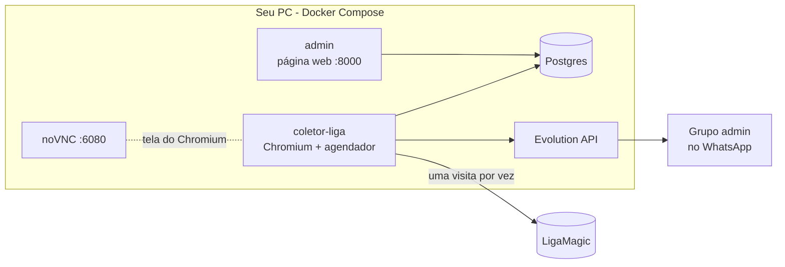

# tcg-sniper

Monitor de preços de produtos selados de Magic: The Gathering (boosters, caixas, kits) na [LigaMagic](https://www.ligamagic.com.br). Uma vez por dia ele lê o catálogo de selados com o menor preço anunciado de cada produto e, para os produtos que você escolher acompanhar, guarda o histórico de venda e o número de lojas. Você administra tudo por uma página web e recebe os avisos num grupo de WhatsApp.

É o primeiro pedaço de um monitor de arbitragem: a ideia é comparar, mais adiante, o preço da LigaMagic com o de outros marketplaces (ver [Roadmap](#roadmap)).

**Estado:** a coleta da LigaMagic, o admin e os avisos no WhatsApp estão prontos e rodando no dia a dia.

## Índice

- [Uso responsável](#uso-responsável)
- [Como funciona](#como-funciona)
- [Pré-requisitos](#pré-requisitos)
- [Instalação passo a passo](#instalação-passo-a-passo)
- [Uso no dia a dia](#uso-no-dia-a-dia)
- [Configuração](#configuração)
- [Solução de problemas](#solução-de-problemas)
- [Desenvolvimento](#desenvolvimento)
- [Roadmap](#roadmap)
- [Licença](#licença)

## Uso responsável

O tcg-sniper foi feito para acessar a LigaMagic como uma pessoa acessaria, em volume baixo:

- **Um acesso por vez, com pausa humana.** Entre uma página e outra há uma pausa aleatória de 8 a 20 segundos. A coleta roda uma vez por dia e nunca há duas ao mesmo tempo.
- **Navegador de verdade.** Usa o Chromium com janela (não headless), com perfil persistente, no seu próprio PC e na sua conexão.
- **Sem burlar proteções.** Não há solucionador de CAPTCHA nem disfarce de navegador. Se o Cloudflare mostrar uma verificação, a coleta pausa, avisa você e espera que uma pessoa a resolva.
- **Só o que a página mostra em texto.** Lê o preço "À partir de" das listagens e o quadro de resumo da página do produto. Os preços de cada loja são desenhados como imagem na página e nunca são decodificados.

Respeite os termos de uso da LigaMagic e não aumente o ritmo da coleta. Este projeto não é afiliado à LigaMagic nem à Wizards of the Coast; Magic: The Gathering é marca da Wizards of the Coast.

## Como funciona



Todo dia, por volta das 10:00:

1. **Listagens.** O coletor abre a listagem de cada categoria de selados (20 por padrão) e clica em "Exibir mais" até mostrar tudo. Daí saem o catálogo e o preço "À partir de" atual de cada produto.
2. **Produtos ativos.** Depois abre a página de cada produto que você marcou como ativo no admin e guarda o número de lojas e o resumo do histórico de venda (mínimo, médio e máximo).
3. **Aviso.** No fim, manda um resumo para o grupo admin do WhatsApp.
4. **Desafio do Cloudflare.** Se aparecer uma verificação no meio do caminho, a coleta pausa e avisa o grupo. Você resolve a verificação pela tela remota (noVNC) e clica em **Retomar** no admin.

Os serviços conversam só pelo banco: o admin grava pedidos ("retomar", "rodar agora") e o coletor os lê a cada minuto.

## Pré-requisitos

- **Um PC que fique ligado no horário da coleta.** Foi feito para Windows com Docker Desktop; também funciona em Linux e macOS.
- **[Docker Desktop](https://www.docker.com/products/docker-desktop/)** (ou Docker Engine com o plugin Compose).
- **[Git](https://git-scm.com/downloads).** No Windows, o Git traz o **Git Bash**: use-o para os comandos deste README.
- **Um chip de WhatsApp secundário.** Nunca use um número pessoal ou de loja: o número fica conectado à Evolution API e manda as mensagens do grupo.
- **Um grupo de WhatsApp de administração**, com você e esse número secundário.

Para desenvolver (opcional): Python 3.12 e [uv](https://docs.astral.sh/uv/). Ver [Desenvolvimento](#desenvolvimento).

## Instalação passo a passo

### 1. Baixe o projeto

```bash
git clone https://github.com/Kyner/tcg-sniper.git
cd tcg-sniper
```

### 2. Crie o `.env`

```bash
cp .env.example .env
```

Abra o `.env` num editor e troque pelo menos:

| Variável | O que colocar |
| --- | --- |
| `ADMIN_SENHA` | Senha da página de admin. |
| `VNC_SENHA` | Senha da tela remota do Chromium. Só os 8 primeiros caracteres valem. |
| `EVOLUTION_API_KEY` | Uma chave longa e aleatória, inventada por você. |
| `HOST_PUBLICO` | O IP deste PC na rede local. No Windows: `ipconfig`, "Endereço IPv4". |

Deixe `WHATSAPP_GRUPO_ADMIN` vazio por enquanto: ele sai do passo 5. Cada variável está explicada no próprio [`.env.example`](.env.example).

### 3. Suba o banco, a Evolution API e o admin

O coletor fica para o passo 6: ao subir, ele já acessa a LigaMagic.

```bash
docker compose up -d --build postgres evolution migrate admin
```

**Deu certo se** `docker compose ps -a` mostrar `postgres`, `evolution` e `admin` em `Up` e `migrate` em `Exited (0)`.

### 4. Conecte o WhatsApp

Carregue a chave do `.env` no terminal e crie a instância (use um nome sem espaços, igual ao `EVOLUTION_INSTANCIA`):

```bash
set -a; . ./.env; set +a

curl -X POST http://localhost:8080/instance/create \
  -H "apikey: $EVOLUTION_API_KEY" -H "Content-Type: application/json" \
  -d '{"instanceName":"tcg-sniper","integration":"WHATSAPP-BAILEYS","qrcode":true}'
```

A resposta traz um QR code (em base64). O jeito mais fácil de lê-lo é pelo painel da Evolution, em http://localhost:8080/manager (entre com a `EVOLUTION_API_KEY`): abra a instância `tcg-sniper`, gere o QR code e leia com o WhatsApp do chip secundário (Aparelhos conectados > Conectar um aparelho).

**Deu certo se** a instância aparecer como conectada no painel.

### 5. Descubra o ID do grupo admin

Com o número secundário já no grupo admin:

```bash
curl "http://localhost:8080/group/fetchAllGroups/tcg-sniper?getParticipants=false" \
  -H "apikey: $EVOLUTION_API_KEY"
```

Procure o grupo pelo nome (`subject`) e copie o `id`, que termina em `@g.us`. Grave no `.env`:

```
WHATSAPP_GRUPO_ADMIN=120363xxxxxxxxxxxx@g.us
```

### 6. Suba o coletor

Faça isso quando puder acompanhar a primeira coleta:

```bash
docker compose up -d --build coletor-liga
```

**Deu certo se** `docker compose logs coletor-liga --tail 20` mostrar `agendador iniciado`, sem erro.

Na primeira vez, como ainda não há nenhuma coleta, ela começa sozinha em até 30 minutos (não espera as 10:00). Para começar já, use **Rodar agora** no admin (passo 7). As listagens de todas as categorias levam cerca de 20 minutos. Dá para acompanhar o Chromium trabalhando pelo noVNC: `http://<HOST_PUBLICO>:6080/vnc.html`, com a `VNC_SENHA`.

Ao final, o grupo admin recebe "N produtos novos no catálogo" e o resumo da coleta.

### 7. Escolha os produtos que quer acompanhar

Abra o admin em `http://<HOST_PUBLICO>:8000` (usuário qualquer, senha `ADMIN_SENHA`) e vá em **Catálogo**. Todo produto novo entra inativo. Ative um por um ou use os filtros e **Ativar todos deste filtro**.

Cada produto ativo é uma visita a mais por dia na LigaMagic (cerca de 17 segundos cada): 50 produtos somam uns 15 minutos; 250, pouco mais de uma hora. Comece com poucos.

A partir da próxima coleta, os produtos ativos ganham histórico de venda e número de lojas. Para não esperar o dia seguinte, clique em **Rodar agora**: como as listagens do dia já foram feitas, só os produtos rodam.

## Uso no dia a dia

### Página de admin

| Tela | Para que serve |
| --- | --- |
| **Início** (`/`) | Estado do coletor e últimas coletas. Botões **Retomar** (depois de resolver um desafio) e **Rodar agora**. |
| **Catálogo** (`/catalogo`) | Todos os produtos, 100 por página. Busca por nome; filtros por situação (todos, ativos, inativos, novos nos últimos 7 dias), por categoria e "só com preço". Ativa ou desativa um produto ou todos os do filtro. |
| **Produto** (`/produto/<id>`) | Preço "À partir de" atual, resumo de venda (mínimo, médio, máximo), número de lojas e o histórico de cada coleta. |

Preço que a página não mostra aparece como "—", nunca como zero.

### Mensagens no WhatsApp

| Mensagem | Quando chega | O que fazer |
| --- | --- | --- |
| **Coleta de DD/MM concluída** | Ao fim de toda coleta sem desafio e sem erro. | Nada; é o resumo do dia. |
| **N produtos novos no catálogo** | Quando a listagem encontra produtos que ainda não estavam no catálogo. | Se quiser acompanhá-los, ative-os pelo link (filtro "novos"). |
| **Desafio Cloudflare na LigaMagic** | Quando aparece uma verificação. A coleta fica pausada. | Resolver pelo noVNC e clicar em **Retomar** (ver abaixo). |
| **... falhou em X de Y** | Quando mais da metade das categorias ou dos produtos falhou. Em geral, a LigaMagic mudou o layout. | Ver os HTMLs salvos em `/data/falhas` e abrir uma issue. |
| **Erro inesperado** / **coleta(s) interrompida(s)** | Erro no meio da coleta, ou o coletor reiniciou no meio de uma. | Ver `docker compose logs coletor-liga` e clicar em **Rodar agora**. |

### Quando chegar um aviso de desafio

1. Abra o noVNC: `http://<HOST_PUBLICO>:6080/vnc.html` (senha `VNC_SENHA`). Funciona pelo celular, na mesma rede.
2. O Chromium está aberto com a verificação na tela. Resolva-a nessa janela.
3. Clique em **Retomar** no admin. Em até 1 minuto a coleta volta, no mesmo navegador.

O coletor nunca tenta de novo sozinho. Se a janela do Chromium for fechada, a próxima coleta abre outra.

### Segurança

O admin e o noVNC usam HTTP sem TLS e são para a rede local. Não exponha as portas 8000 e 6080 para a internet. A Evolution API (8080) e o Postgres (5432) só escutam em `127.0.0.1`.

## Configuração

Tudo fica no `.env`, e cada variável está explicada no [`.env.example`](.env.example). As que você mais vai querer mexer:

| Variável | Padrão | Para quê |
| --- | --- | --- |
| `COLETA_HORA` / `COLETA_JITTER_MIN` | `10:00` / `30` | Horário da coleta diária e a variação aleatória em minutos. |
| `LIGA_CATEGORIAS` | 20 categorias de selados | Quais listagens varrer. Tire uma categoria que falhe todo dia. |
| `PAUSA_MIN_S` / `PAUSA_MAX_S` | `8` / `20` | Pausa entre páginas. Reduzir aumenta a chance de desafio. |
| `LIMITE_FALHA_PCT` | `50` | A partir de quantos % de falhas a coleta vira "falha" e avisa o grupo. |

Depois de mudar o `.env`, recrie os containers: `docker compose up -d`.

## Solução de problemas

**O coletor não sobe e o log diz "defina VNC_SENHA".** A `VNC_SENHA` está vazia ou com o valor padrão. Troque no `.env` e rode `docker compose up -d coletor-liga`.

**O admin não sobe e o log fala de "ADMIN_SENHA".** Mesmo caso: defina uma senha própria.

**A Evolution não sobe e o log reclama do banco `evolution`.** O script que cria o banco `evolution` só roda num volume novo do Postgres. Crie à mão:
`docker compose exec postgres psql -U tcg -c "CREATE DATABASE evolution;"`

**Nenhuma mensagem chega no WhatsApp.** Confira se a instância está conectada no painel da Evolution e se `EVOLUTION_API_KEY`, `EVOLUTION_INSTANCIA` e `WHATSAPP_GRUPO_ADMIN` estão preenchidos. Sem algum deles, os avisos vão só para o log (`docker compose logs coletor-liga`); com a chave padrão ou o grupo vazio, o coletor avisa isso no log ao subir.

**Uma categoria falha todo dia.** Ela pode ter ficado vazia, ou ter um produto só (a LigaMagic então abre direto a página do produto). Tire o ID de `LIGA_CATEGORIAS`.

**Um produto aparece sem preço e com 0 lojas.** É normal: a LigaMagic não mostra o quadro de preços de produtos sem nenhuma loja e sem venda registrada.

**O painel da Evolution diz "Missing base64 data and mediaUrl" ao abrir uma foto ou áudio.** É esperado e não afeta o projeto. A Evolution não guarda o conteúdo das mídias por padrão, e o tcg-sniper só envia texto, sem ler mensagens. Configurar armazenamento de mídia (S3, Cloudflare R2, MinIO) não é necessário e não está no escopo.

**O logo do painel da Evolution aparece quebrado.** É só visual e não afeta nada.

## Desenvolvimento

```bash
cp .env.example .env
docker compose up -d postgres     # o banco de testes (tcg_test) é criado junto
uv sync
uv run playwright install chromium
uv run pytest
uv run ruff check
```

Nenhum teste acessa a LigaMagic ou o WhatsApp reais: os parsers são testados com páginas salvas em `tests/fixtures/liga`, e o navegador e o WhatsApp têm versões falsas nos testes. Os 3 testes de `tests/coletor_liga/test_navegador.py` abrem um Chromium com uma página local e só rodam com `TESTAR_NAVEGADOR=1`.

Para rodar um serviço fora do Docker: `uv run tcg-sniper migrate`, `uv run tcg-sniper admin` ou `uv run tcg-sniper coletor-liga`.

### Estrutura

```
src/tcg_sniper/
  cli.py              comandos migrate, admin e coletor-liga
  config.py           leitura do .env
  coletor_liga/       agendador, navegador (Playwright), parsers e as duas etapas da coleta
  admin/              página de admin (FastAPI + Jinja2 + HTMX)
  db/                 modelos, repositório e migrações (SQLAlchemy + Alembic)
  notificador/        envio para o WhatsApp (Evolution API) ou para o log
docker/               entrypoint do coletor (Xvfb, VNC, noVNC) e script inicial do Postgres
scripts/              captura de páginas reais para as fixtures
tests/                testes (pytest)
docs/superpowers/     especificação e plano de implementação
```

### Quando a LigaMagic muda o layout

1. Pegue o HTML que falhou em `/data/falhas` (`docker compose cp coletor-liga:/data/falhas/<arquivo> .`).
2. Ou capture uma página nova: `uv run python scripts/capturar_fixture.py <url> <nome>` (com `--expandir` para uma listagem).
3. Adicione a página em `tests/fixtures/liga`, escreva o teste que falha e ajuste `src/tcg_sniper/coletor_liga/parsers.py`. O docstring do arquivo descreve a estrutura esperada de cada página.
4. Antes de commitar, recorte a página: `uv run python scripts/recortar_fixture.py tests/fixtures/liga/<nome>.html`. O repositório guarda só os trechos que os parsers leem, nunca a página inteira. O script confere que os parsers dão o mesmo resultado no original e no recorte; se ele recusar, inclua os blocos novos que o parser passou a ler na lista do script.

O desenho completo está em [`docs/superpowers/specs/2026-10-13-coletor-liga-design.md`](docs/superpowers/specs/2026-10-13-coletor-liga-design.md).

## Roadmap

1. **Coleta da LigaMagic, admin e avisos no WhatsApp.** Pronto.
2. **Coletores de outros marketplaces** (Mercado Livre, Amazon e outros).
3. **Casamento de produtos** entre os marketplaces, com uma fila de revisão manual.
4. **Motor de oportunidades**, considerando cupons e cashback.
5. **Mensagens de oportunidade** num segundo grupo de WhatsApp.

## Licença

[MIT](LICENSE).
